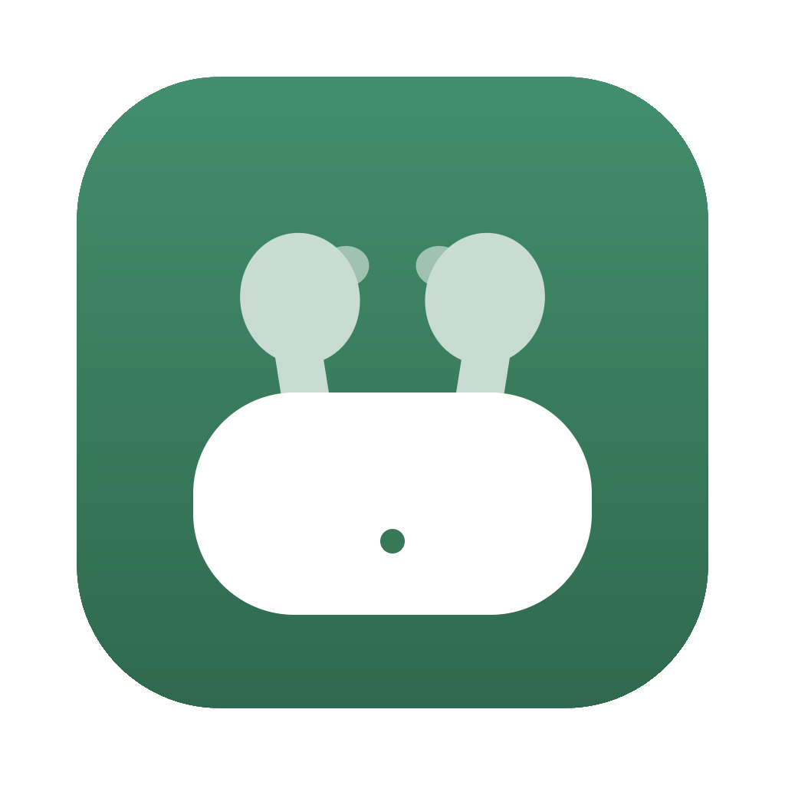
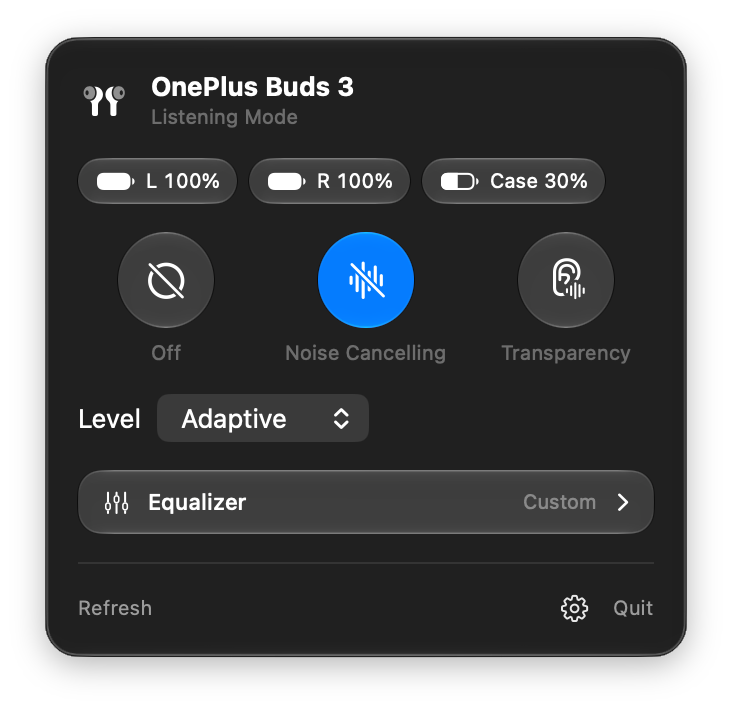

<p align="center">
  
</p>

<h1 align="center">BudsDeck</h1>

<p align="center">
  <b>Your OnePlus, OPPO and realme earbuds, controlled from the Mac menu bar.</b><br>
  Noise cancelling, EQ and battery without a phone or the HeyMelody app.
</p>

<p align="center">
  <a href="https://github.com/notacp/BudsDeck/releases"></a>
  <a href="https://github.com/notacp/BudsDeck/releases/latest"></a>
  
  <a href="LICENSE"></a>
</p>

<p align="center">
  <a href="https://github.com/notacp/BudsDeck/releases/latest/download/BudsDeck.dmg"></a>
</p>

<p align="center">
  
</p>

OnePlus earbuds are set up through HeyMelody, a phone app that has disappeared from the US App Store and has never existed for the Mac. BudsDeck talks to the earbuds over the same Bluetooth protocol, directly from your Mac.

## Features

- **Noise control:** Off, Noise Cancelling and Transparency, with ANC levels Adaptive, Max, Moderate and Mild
- **Equalizer:** Balanced, Bold, Serenade and Bass presets, plus a 6-band custom EQ (62 Hz–16 kHz, ±6 dB) saved on the buds
- **Battery** for each bud and the case, with a charging indicator
- **Native and light:** a Liquid Glass panel in the menu bar, a single 500 KB download
- **Stays current:** tells you when an update is out; **Report a Problem…** opens a pre-filled GitHub issue

## Install

1. **[Download BudsDeck.dmg](https://github.com/notacp/BudsDeck/releases/latest/download/BudsDeck.dmg)**, open it and drag **BudsDeck** into **Applications**.
2. **First launch only:** BudsDeck isn't notarized by Apple yet, so macOS blocks it once. Open BudsDeck, click **Done** on the warning, then go to **System Settings → Privacy & Security** and click **Open Anyway**.
3. Allow **Bluetooth** access when asked. Tick **Open at Login** in the gear menu to start it automatically.

Prefer Terminal for step 2? This removes the download quarantine flag:

```sh
xattr -dr com.apple.quarantine /Applications/BudsDeck.app
```

Requires **macOS 26 or later**, on Apple Silicon or Intel.

## Compatibility

| Earbuds | Status |
|---|---|
| OnePlus Buds 3 | ✅ Tested: noise modes, ANC levels, EQ presets, custom EQ, battery |
| Other OnePlus, OPPO Enco and realme buds | Should connect (same protocol). Mode bits and EQ presets can differ per model |

Using it with other earbuds? [Open an issue](https://github.com/notacp/BudsDeck/issues/new) with what works, or use **Report a Problem…** in the app.

## FAQ

<details>
<summary><b>Noise control won't change</b></summary>

Wear at least one bud. The earbuds' firmware rejects noise-mode changes while both buds are out of your ears, and BudsDeck shows a notice instead.
</details>

<details>
<summary><b>"BudsDeck can't be opened" or "could not verify" on first launch</b></summary>

Expected for apps that aren't notarized yet. Use **System Settings → Privacy & Security → Open Anyway**, or the `xattr` command above. You only do this once.
</details>

<details>
<summary><b>Another app can't talk to my buds while BudsDeck runs</b></summary>

The buds accept a single control connection. Quit BudsDeck before using another tool that controls them.
</details>

<details>
<summary><b>The case battery looks old</b></summary>

The buds only report the case while they're docked or right after the lid opens. BudsDeck shows the most recent reading until a fresh one arrives.
</details>

<details>
<summary><b>I made custom EQs in HeyMelody. Will BudsDeck overwrite them?</b></summary>

BudsDeck edits whichever custom EQ is currently selected. Named custom EQs are kept; unnamed flat "Custom" placeholder slots may merge into one.
</details>

<details>
<summary><b>The ANC levels sound swapped</b></summary>

The level order (Max, Moderate, Mild, Adaptive) comes from a verified Buds 4 / Buds Pro 3 implementation and matches Buds 3 behaviour, but hasn't been confirmed by ear on every model. Please open an issue with your model.
</details>

## Privacy

BudsDeck sends a few **anonymous** events so the maintainer can see roughly how many people use it and whether it works for them. No names, emails, IP addresses (discarded), Bluetooth addresses or listening activity. Turn it off any time: gear menu → **Share Anonymous Usage Stats**.

<details>
<summary><b>Exactly what's sent</b></summary>

Usage events go out **at most once per day**; a crash report goes out once per crash (at most 3 per launch).

| Event | When | Why |
|---|---|---|
| `app_launched` | the app runs | count installs, including ones where the earbuds never connect |
| `app_active` | your earbuds connect | count working installs, by model |
| `connect_failed` | connecting fails, with a reason code (`no_compatible_device`, `permission_denied`, `timeout`, `open_failed`) | find what's broken for whom |
| `$exception` | on launch, if BudsDeck crashed since last time | fix crashes: crash type (e.g. `EXC_BREAKPOINT`) and **BudsDeck's own function names** from the crash report only, no file paths or memory contents |

| Sent | Not sent |
|---|---|
| A random install ID created on first launch | Your name, email or Apple ID |
| App version, macOS version, Apple Silicon or Intel | Your IP address (discarded by the analytics project) |
| The earbuds' model, e.g. "OnePlus Buds 3", picked from a fixed list of known models (otherwise "other"), and the model code the earbuds report (e.g. `063C14`, identical for every unit of that model) | Your earbuds' Bluetooth name if you renamed them, Bluetooth addresses, settings, listening activity |

**Report a Problem…** opens a GitHub issue pre-filled with your BudsDeck and macOS versions, earbuds model, last connection problem and last crash summary. You see all of it in your browser and choose whether to submit it.

**Update check:** once a day BudsDeck asks GitHub's public API for the latest release. That request sends nothing about you and works even with usage stats off.

The code is in `Telemetry`, `CrashReporter` and `Updater` in [`BudsDeck.swift`](BudsDeck.swift).
</details>

## Build from source

You need the **Xcode 26 command-line tools** (`xcode-select --install`); older tools lack the Liquid Glass APIs.

```sh
git clone https://github.com/notacp/BudsDeck.git
cd BudsDeck
./build.sh        # builds, runs a self-test, installs to ~/Applications and restarts the app
```

- `./build.sh --dmg` makes the release DMG (universal, ad-hoc signed).
- Ad-hoc builds re-ask for Bluetooth permission after every rebuild. To keep the grant, put your own signing identity in an untracked `local.env` (see `build.sh`).

## How it works

The buds expose a vendor serial service ("enco link", RFCOMM, UUID `0000079a-d102-11e1-9b23-00025b00a5a5`). BudsDeck opens it with IOBluetooth and sends small framed commands, documented in [docs/PROTOCOL.md](docs/PROTOCOL.md).

Everything is in one Swift file, [`BudsDeck.swift`](BudsDeck.swift): the protocol codec, the Bluetooth link and the SwiftUI panel.

## Credits

Prior open-source work on this protocol family:
[omarchy-headphones `oppo-bridge`](https://github.com/ncr/omarchy-headphones) (Linux, frame format),
[Gadgetbridge](https://codeberg.org/Freeyourgadget/Gadgetbridge) (OPPO Enco support),
[OnePlus Buds Windows Companion](https://github.com/Thomaspatrick14/Oneplus-buds-Win-Companion) (EQ preset IDs).

## Disclaimer

BudsDeck is an independent project. It is not affiliated with, endorsed by or supported by OnePlus, OPPO or realme. Product names are trademarks of their owners and are used here only to describe compatibility. Commands are sent to your earbuds at your own risk; everything BudsDeck changes can also be changed back in the official app.

## License

[MIT](LICENSE)
